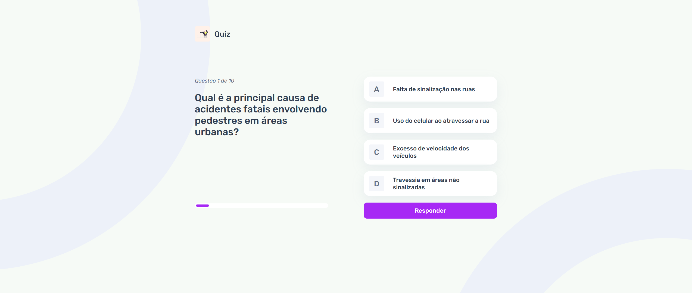
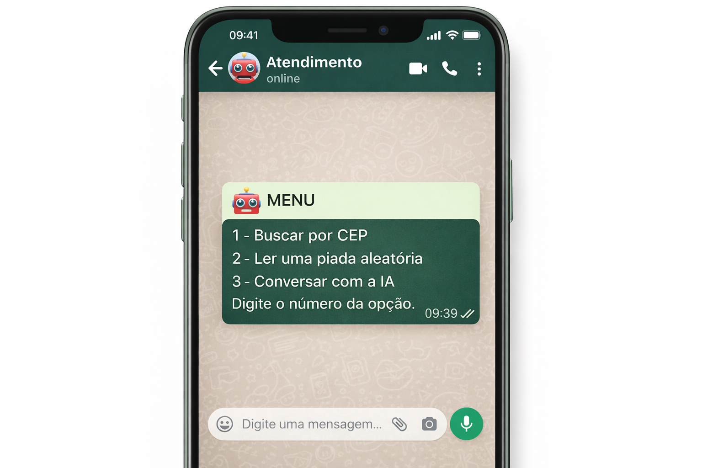

  

<h1 align="center">Hi 👋, I'm Eduardo Oliveira</h1>

<h3 align="center">Front-End &amp; Back-End Developer · Automation</h3>

  <samp>Interfaces. APIs. Automations. Real-world impact.</samp>

  Building professional web solutions that connect design, performance and business results.
   
  São Paulo, Brazil

 

<h2 align="center">🚀 About Me</h2>

I'm **Eduardo**, a developer focused on turning ideas into useful web experiences — from the interface to the integrations behind it.

I build **responsive websites, landing pages and JavaScript applications**, combining clear design with practical functionality.

On the back end, I work with **Node.js, API integrations and WhatsApp automation**, including AI-powered customer service flows.

I'm currently improving my **JavaScript and Node.js** projects and exploring how AI can support real business workflows.

My goal is simple: **build solutions that look professional, work well and make a real difference.**

 

<h2 align="center">🤝 Connect</h2>

  
  &nbsp;
  

  <a href="https://wa.me/5511990073671">WhatsApp</a>
  &nbsp;·&nbsp;
  <a href="https://eduardo-oliveira-desenvolvimento-e.vercel.app/">Portfolio</a>

<h2 align="center">💻 Tech Stack</h2>

  

  

Responsive interfaces &nbsp;·&nbsp; API integrations &nbsp;·&nbsp; AI-powered automation

 

<h2 align="center">🛠️ Featured Projects</h2>

<table>
  <tr>
    <td width="50%" valign="top">
      <h3>⚖️ Ilima Advogados</h3>
      
      
A professional landing page for a law firm, focused on credibility, clear communication and client conversion.

      
HTML · CSS · JavaScript · Vercel

      <a href="https://github.com/Eduuh1227/ilima-advogados">View code →</a>
    </td>
    <td width="50%" valign="top">
      <h3>🧠 Quiz Extensivo</h3>
      
      
An interactive quiz with JavaScript logic, a guided question flow, a responsive interface and user feedback.

      
HTML · CSS · JavaScript · Vercel

      <a href="https://quiz-extensivo.vercel.app/">View project →</a>
    </td>
  </tr>
  <tr>
    <td width="50%" valign="top">
      <h3>🤖 WhatsApp Bot with AI</h3>
      
      
Customer service automation with dynamic menus, API integrations and AI responses.

      
Node.js · APIs · WhatsApp Web · AI

      <a href="https://github.com/Eduuh1227/bot-whatsappweb/tree/bot-webwhatsapp">View code →</a>
    </td>
    <td width="50%" valign="top">
      <h3>💼 Portfolio Website</h3>
      
My personal space to share projects, skills and the work I build across front-end development, back-end integrations and automation.

      
Explore the projects and get in touch to discuss an idea.

      
HTML · CSS · JavaScript · Vercel

      <a href="https://eduardo-oliveira-desenvolvimento-e.vercel.app/">View portfolio →</a>
    </td>
  </tr>
</table>

<h2 align="center">🎯 Current Focus</h2>

- Building professional, responsive websites and landing pages.
- Improving JavaScript applications and Node.js integrations.
- Developing customer service bots and useful automations.
- Exploring AI applied to real business workflows.

 

<h2 align="center">📊 GitHub Stats</h2>

  

<h2 align="center">📈 Activity Graph</h2>

  

---

  <samp>Code with purpose. Design with clarity. Build for real results.</samp>

