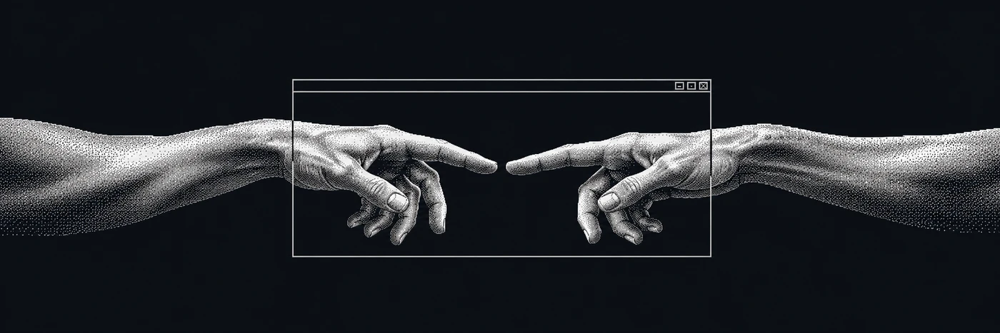
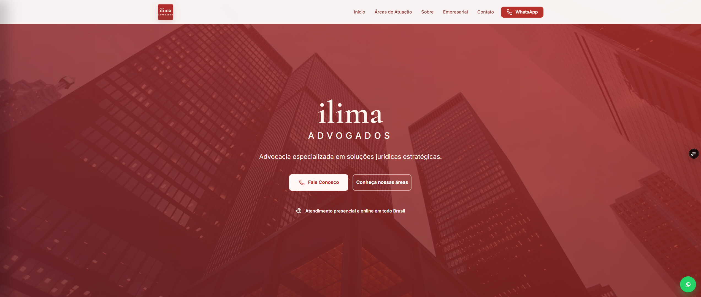
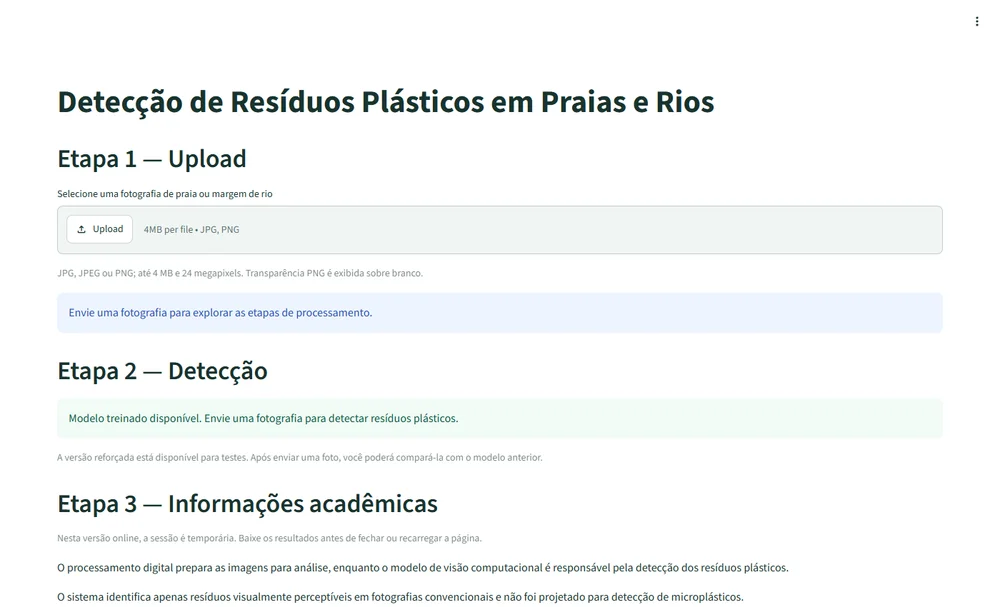
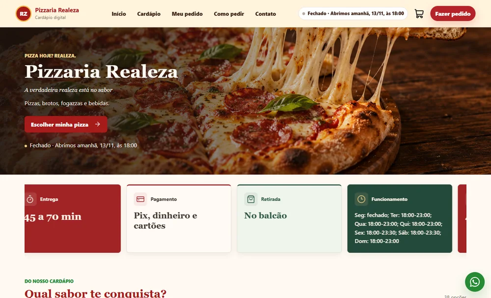
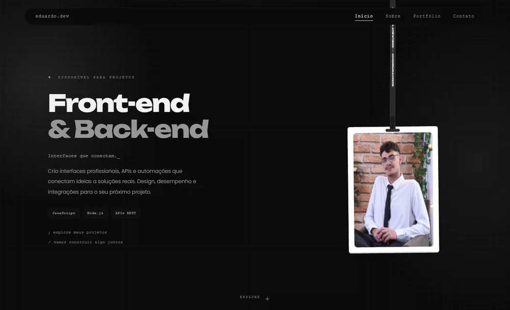

  

<h1 align="center">Hi 👋, I'm Eduardo Oliveira</h1>

<h3 align="center">Front-End &amp; Back-End Developer · Automation</h3>

  <samp>Interfaces. APIs. Automations. Real-world impact.</samp>

  Building professional web solutions that connect design, performance and business results.
   
  São Paulo, Brazil

 

<h2 align="center">🚀 About Me</h2>

I'm **Eduardo**, a developer focused on turning ideas into useful web experiences — from the interface to the integrations behind it.

I build **responsive websites, landing pages and JavaScript applications**, combining clear design with practical functionality.

On the back end, I work with **Node.js, API integrations and WhatsApp automation**, including AI-powered customer service flows.

I'm currently improving my **JavaScript and Node.js** projects and exploring how AI can support real business workflows.

My goal is simple: **build solutions that look professional, work well and make a real difference.**

 

<h2 align="center">🤝 Connect</h2>

  
  &nbsp;
  

  <a href="https://wa.me/5511990073671">WhatsApp</a>
  &nbsp;·&nbsp;
  <a href="https://eduardo-oliveira-desenvolvimento-e.vercel.app/">Portfolio</a>

<h2 align="center">💻 Tech Stack</h2>

  

  

  
  
  

  
  

Responsive interfaces &nbsp;·&nbsp; E-commerce &nbsp;·&nbsp; API integrations &nbsp;·&nbsp; AI-powered automation

 

<h2 align="center">🛠️ Featured Projects</h2>

<table>
  <tr>
    <td width="50%" valign="top">
      <h3>⚖️ Ilima Advogados</h3>
      
      
A professional landing page for a law firm, focused on credibility, clear communication and client conversion.

      
HTML · CSS · JavaScript · Vercel

      <a href="https://ilima-advogados-s9pl.vercel.app/">View project →</a>
      &nbsp;·&nbsp;
      <a href="https://github.com/Eduuh1227/ilima-advogados">View code →</a>
    </td>
    <td width="50%" valign="top">
      <h3>♻️ Detector de Plásticos</h3>
      
      
An academic computer vision project for comparing image-processing techniques and experimenting with YOLO detection of visible plastic waste in beach and river photos.

      
Python · OpenCV · NumPy · YOLO · Streamlit

      <a href="https://projeto-detector-de-pl-sticos.vercel.app/">View project →</a>
      &nbsp;·&nbsp;
      <a href="https://github.com/Eduuh1227/Projeto-Detector-de-Pl-sticos-">View code →</a>
    </td>
  </tr>
  <tr>
    <td width="50%" valign="top">
      <h3>🍕 Pizzaria Realeza</h3>
      
      
A responsive pizzeria website with a digital menu, customizable pizzas, a shopping cart, order tracking and an administrative panel.

      
HTML · CSS · JavaScript · Node.js · PostgreSQL · Vercel

      <a href="https://projeto-pizzaria-mu.vercel.app/">View project →</a>
      &nbsp;·&nbsp;
      <a href="https://github.com/Eduuh1227/Projeto-Pizzaria">View code →</a>
    </td>
    <td width="50%" valign="top">
      <h3>💼 Portfolio Website</h3>
      
      
My personal space to share projects, skills and the work I build across front-end development, back-end integrations and automation.

      
Explore the projects and get in touch to discuss an idea.

      
HTML · CSS · JavaScript · Vercel

      <a href="https://eduardo-oliveira-desenvolvimento-e.vercel.app/">View portfolio →</a>
    </td>
  </tr>
</table>

<h2 align="center">🎯 Current Focus</h2>

- Building professional, responsive websites and landing pages.
- Improving JavaScript applications and Node.js integrations.
- Developing customer service bots and useful automations.
- Exploring AI applied to real business workflows.

 

<h2 align="center">📊 GitHub Stats</h2>

  

<h2 align="center">📈 Activity Graph</h2>

  

---

  <samp>Code with purpose. Design with clarity. Build for real results.</samp>

